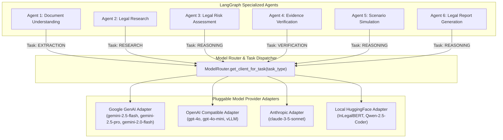
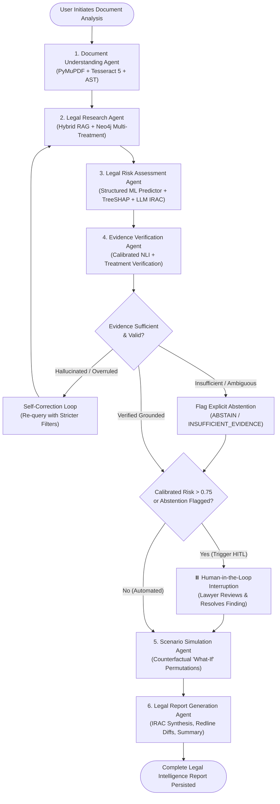

# LegalLens AI – Multi-Agent AI System Design (LangGraph)
**Document Version:** 1.1.0  
**Framework:** LangGraph (StateGraph) + LangChain + Python 3.11+  
**Model Strategy:** Pluggable Model Abstraction Layer with Task-Specific Dynamic Routing  
**Status:** Approved with Technical Refinements  

---

## 1. Model Abstraction Layer & Dynamic Routing Strategy

To prevent vendor lock-in and avoid fragile hardcoded assumptions, LegalLens AI decouples the agent orchestration logic from underlying foundation model providers via a unified **Model Abstraction Layer**.



### 1.1 Environment-Configured Model Mapping
All model IDs are injected dynamically via environment variables, allowing seamless provider switching:

| Task Type | Environment Variable | Default Recommended Model | Rationale & Performance Profile |
| :--- | :--- | :--- | :--- |
| **Document Extraction** | `LLM_MODEL_EXTRACTION` | `gemini-2.5-flash` (or compatible) | High throughput, sub-second latency, long context window for massive commercial deeds. |
| **Legal Research** | `LLM_MODEL_RESEARCH` | `gemini-2.5-flash` (or compatible) | Fast structured query formulation and JSON parsing for hybrid retrieval. |
| **Evidence Verification** | `LLM_MODEL_VERIFICATION` | `gemini-2.5-pro` (or compatible) | High-precision adversarial reasoning to challenge citations and detect discrepancies. |
| **In-Depth Reasoning** | `LLM_MODEL_REASONING` | `gemini-2.5-pro` (or compatible) | Complex legal IRAC synthesis, multi-variable counterfactual scenario simulation. |

---

## 2. Multi-Agent Orchestration Architecture (LangGraph)



---

## 3. Shared State Schema (`LegalLensGraphState`)

```python
from typing import List, Dict, Optional, Any, Literal
from pydantic import BaseModel, Field
from typing_extensions import TypedDict

class BoundingBox(BaseModel):
    page: int
    x0: float
    y0: float
    x1: float
    y1: float

class ClauseAST(BaseModel):
    clause_id: str
    clause_number: str
    clause_title: Optional[str] = None
    raw_text: str
    clause_type: str
    page_span: List[int]
    bounding_boxes: List[BoundingBox] = []
    cross_references: List[str] = []
    token_length: int

class StatutoryEvidence(BaseModel):
    india_code_act_title: str
    section_number: str
    section_title: str
    exact_text_excerpt: str
    official_source_url: str

class JudicialPrecedentEvidence(BaseModel):
    case_title: str
    digiscr_neutral_citation: str
    court: str
    decision_date: str
    bench_strength: int
    exact_ratio_excerpt: str
    treatment_status: Literal["ACTIVE", "OVERRULED", "REVERSED", "DISTINGUISHED", "MODIFIED"]
    treatment_details: Optional[str] = None

class StructuredClauseFeatures(BaseModel):
    clause_length_tokens: int
    liability_cap_ratio: float
    has_unilateral_termination: bool
    indemnity_carveouts_count: int
    non_compete_duration_months: int
    jurisdiction_divergence_flag: bool
    ambiguity_entropy_score: float
    penalty_doctrine_indicator: bool

class SHAPFeatureAttribution(BaseModel):
    feature_name: str
    feature_value: Any
    attribution_weight: float

class RiskFinding(BaseModel):
    clause_id: str
    clause_number: str
    category: str
    severity: Literal["CRITICAL", "HIGH", "MEDIUM", "LOW", "INFORMATIONAL"]
    calibrated_risk_score: float # Computed by Structured ML Model
    
    # Decoupled Explainability
    structured_features: StructuredClauseFeatures
    shap_attributions: List[SHAPFeatureAttribution]
    base_value: float
    
    # LLM Qualitative Narrative (IRAC Format)
    qualitative_irac: Dict[str, str] # {"issue": "...", "rule": "...", "application": "...", "conclusion": "..."}
    
    # Stored Exact Evidence
    statutory_evidence: List[StatutoryEvidence] = []
    precedent_evidence: List[JudicialPrecedentEvidence] = []
    mitigation_text: str

class VerificationResult(BaseModel):
    clause_id: str
    is_verified: bool
    calibrated_nli_score: float
    is_abstention: bool
    abstention_reason: Optional[Literal["INSUFFICIENT_EVIDENCE", "CONFLICTING_AUTHORITIES", "AMBIGUOUS_STATUTORY_INTERPRETATION"]] = None
    unverified_citations: List[str] = []
    adverse_treatment_detected: bool
    verification_notes: str

class LegalLensGraphState(TypedDict):
    session_id: str
    tenant_id: str
    document_id: str
    jurisdiction: str
    
    # Document Pipeline
    clauses: List[ClauseAST]
    
    # Research & Grounding
    retrieved_statutes: List[StatutoryEvidence]
    retrieved_precedents: List[JudicialPrecedentEvidence]
    
    # Risk Assessment
    identified_risks: List[RiskFinding]
    aggregate_risk_score: float
    
    # Evidence & Verification
    verification_results: List[VerificationResult]
    citation_retry_count: int
    
    # Human-In-The-Loop Control
    hitl_required: bool
    hitl_approved: bool
    hitl_reviewer_notes: Optional[str]
    
    # Simulations & Final Report
    simulations: List[Dict[str, Any]]
    final_report: Optional[Dict[str, Any]]
    
    # Observability & Cost Telemetry
    agent_spans: List[Dict[str, Any]]
    total_prompt_tokens: int
    total_completion_tokens: int
    estimated_cost_usd: float
```

---

## 4. In-Depth Agent Specifications

### 4.1 Agent 1: Document Understanding Agent
- **Model Used:** `LLM_MODEL_EXTRACTION` (Default: `gemini-2.5-flash` or compatible)
- **Role:** Converts raw document bytes/OCR streams into hierarchical AST representations with bounding-box tags.
- **Workflow:**
  1. Inspect PDF structure; execute OpenCV deskewing + Tesseract 5 OCR if native text is absent.
  2. Segment contract into numbered clauses (`1.0`, `1.1`, `(a)`).
  3. Classify clauses against legal taxonomy (*Indemnity, Limitation of Liability, Termination, Governing Law, Arbitration, Non-Compete, Confidentiality, Force Majeure*).

---

### 4.2 Agent 2: Legal Research Agent (Hybrid GraphRAG)
- **Model Used:** `LLM_MODEL_RESEARCH` (Default: `gemini-2.5-flash` or compatible)
- **Role:** Queries sovereign Indian legal corpora (**India Code** & **DigiSCR**) combining vector, sparse, and graph search.
- **Workflow:**
  1. Generate dense vector queries and BM25 statutory search queries.
  2. Execute Reciprocal Rank Fusion (RRF) across Qdrant and BM25 indices.
  3. Re-rank top candidates using Cross-Encoder `BAAI/bge-reranker-large`.
  4. Query Neo4j to inspect judicial treatment status:
     - Check whether candidate precedent is `OVERRULED`, `REVERSED`, `DISTINGUISHED`, or `MODIFIED`.
     - Suppress overruled authorities automatically; flag modified precedents with caution markers.

---

### 4.3 Agent 3: Legal Risk Assessment Agent (Structured ML + TreeSHAP + LLM)
- **Architecture:** Hybrid Decoupled Explainability.
- **Step 1: Structured Feature Extraction & ML Risk Classification**
  - Extract engineered tabular features (`clause_length`, `liability_cap_ratio`, `has_unilateral_termination`, `indemnity_carveouts`, `non_compete_duration`, `jurisdiction_divergence`, `ambiguity_entropy`, `penalty_indicator`).
  - Pass feature vector into a dedicated **LightGBM / XGBoost** risk classifier trained on the proposed `LegalLens-Risk-IN` dataset.
  - Predict calibrated risk probability $P(\text{Risk}) \in [0.0, 1.0]$.
- **Step 2: TreeSHAP Feature Attribution**
  - Compute exact Shapley values on the predictive model using `TreeSHAP`.
  - Output exact marginal contributions of each structured feature to the risk score.
- **Step 3: LLM Qualitative Legal Narrative Generation**
  - Model: `LLM_MODEL_REASONING` (Default: `gemini-2.5-pro` or compatible).
  - Synthesize IRAC legal rationale referencing the exact clause text and retrieved statutory provisions from India Code.

---

### 4.4 Agent 4: Evidence Verification Agent (Calibrated NLI & Source Traceability)
- **Model Used:** `LLM_MODEL_VERIFICATION` (Default: `gemini-2.5-pro` or compatible) + NLI Cross-Encoder (`nli-deberta-v3-large`).
- **Role:** Adversarial verification and hallucination elimination.
- **Key Refinements:**
  1. **NLI as Supporting Signal:** The NLI entailment score is treated as a probabilistic supporting heuristic, calibrated via Platt scaling on legal domain data, never as deterministic mathematical proof.
  2. **Source Traceability:** Verifies that every assertion links directly to an authoritative excerpt from India Code or DigiSCR.
  3. **Explicit Abstention:** If supporting evidence is insufficient, contradictory, or absent, the agent sets `is_abstention = True` and records `ABSTAIN / INSUFFICIENT_EVIDENCE`.
  4. **Adverse Treatment Verification:** Flags cases that have been overruled or reversed.

---

### 4.5 Agent 5: Scenario Simulation Agent (Counterfactual Modeling)
- **Model Used:** `LLM_MODEL_REASONING` (Default: `gemini-2.5-pro` or compatible).
- **Role:** Perturbs contractual parameters to stress-test outcomes:
  - *Material Breach Permutation:* Tests whether liquidated damages operate as an unenforceable penalty under Section 74 of the Indian Contract Act (*Kailash Nath v. DDA*).
  - *Insolvency Event:* Simulates CIRP moratorium under Section 14 of the Insolvency and Bankruptcy Code (IBC), 2016.
  - *Unilateral Termination:* Evaluates substituted performance under Section 20 of the Specific Relief Act (as amended in 2018).

---

### 4.6 Agent 6: Legal Report Generation Agent
- **Model Used:** `LLM_MODEL_REASONING` (Default: `gemini-2.5-pro` or compatible).
- **Role:** Synthesizes an executive legal memorandum in formal IRAC format, generates character-level redline diffs using `diff-match-patch`, and prepares exportable formats (PDF/DOCX/JSON).

---

## 5. Prompt Versioning & Configuration Management

Prompts are decoupled from code into semver-versioned YAML configurations (`/prompts/`):
```yaml
# /prompts/risk_assessment_v1.2.0.yaml
metadata:
  prompt_id: "risk_assessment_irac"
  version: "1.2.0"
  task: "REASONING"
  author: "LegalLens AI Architecture Team"
  jurisdiction: "IN"
template: |
  [SYSTEM INSTRUCTION]
  You are the LegalLens Legal Risk Assessment Specialist for Indian Law.
  Evaluate the provided contract clause within the untrusted boundary.
  
  <untrusted_contract_clause>
  {clause_text}
  </untrusted_contract_clause>
  
  Retrieved Statutory Ground Truth:
  {statutory_context}
  
  Output structured IRAC rationale strictly referencing the above statutes.
```

---

## 6. Observability, Tracing & Cost Accounting

1. **Distributed Tracing (OpenTelemetry / Langfuse):** Every LangGraph invocation creates a root trace with parent-child spans for each agent node, logging execution latency, node input/output digests, and retry attempts.
2. **Real-Time Token & Cost Monitoring:** Every LLM call logs prompt tokens, completion tokens, and model identifier to Redis. The Express Gateway aggregates real-time usage per tenant workspace, enforcing monthly cost quotas.
