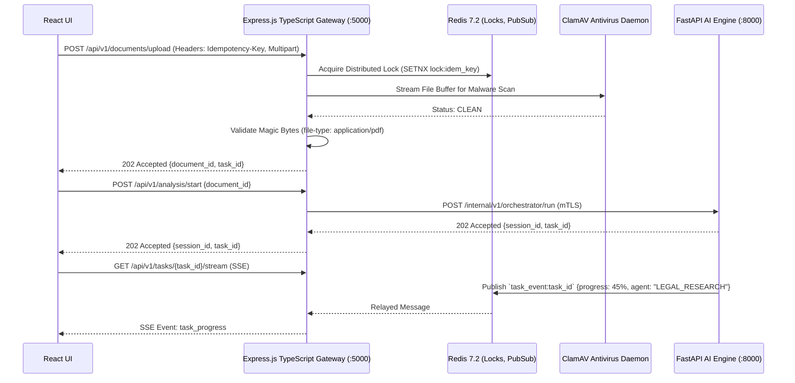

# LegalLens AI – API Specification & Service Communication
**Document Version:** 1.1.0  
**Specification Standard:** OpenAPI 3.1 & AsyncAPI 2.6  
**Implementation:** Express.js Gateway (Node.js 22/24 LTS + TypeScript 5.x) & FastAPI AI Engine  
**Status:** Approved with Technical Refinements  

---

## 1. Architectural Protocols & Communication Topology



---

## 2. Global Headers & Idempotency Standard

### 2.1 Request Headers
```http
Authorization: Bearer <JWT_ACCESS_TOKEN>
Content-Type: application/json
Idempotency-Key: 9b1deb4d-3b7d-4bad-9bdd-2b0d7b3dcb6d
X-Workspace-ID: 673f8a9e102f4a56b2300001
X-Correlation-ID: a1b2c3d4-e5f6-7890-abcd-ef1234567890
X-Jurisdiction: IN
```

### 2.2 Idempotency Contract
All `POST` and state-mutating requests accept an `Idempotency-Key` header (UUIDv4).
- The Express Gateway attempts an atomic `SETNX` lock in Redis with a 120-second TTL.
- If a duplicate in-flight request arrives, the gateway returns `409 Conflict` (`IDEMPOTENCY_IN_PROGRESS`).
- When the operation succeeds, the response payload is cached against the key for 24 hours. Subsequent retries receive the cached response immediately.

---

## 3. Express.js Gateway API Endpoints (External)

### 3.1 Document Ingestion & Malware Scanning (`/api/v1/documents`)

#### `POST /api/v1/documents/upload`
- **Description:** Ingests contracts, executes ClamAV virus scanning, validates magic bytes, computes SHA-256, writes to encrypted temporary storage, and registers an asynchronous OCR background task.
- **Request:** `multipart/form-data`
  - `file`: binary (PDF, DOCX, TIFF; max 50MB)
  - `document_type`: enum (`CONTRACT_MSA`, `CONTRACT_NDA`, etc.)
  - `jurisdiction`: string (`IN`, `UK`, `US`)
- **Response (202 Accepted):**
```json
{
  "document_id": "673f8a9e102f4a56b2300099",
  "task_id": "task_ocr_98124a",
  "filename": "Master_Services_Agreement_2026.pdf",
  "sha256": "e3b0c44298fc1c149afbf4c8996fb92427ae41e4649b934ca495991b7852b855",
  "detected_magic_mime": "application/pdf",
  "malware_scan": {
    "status": "CLEAN",
    "engine": "ClamAV"
  },
  "created_at": "2026-11-23T11:15:00Z"
}
```

---

### 3.2 Background Task Status (`/api/v1/tasks`)

#### `GET /api/v1/tasks/:task_id`
- **Description:** Polls execution progress, retries, and result for background OCR, analysis, or simulation tasks.
- **Response (200 OK):**
```json
{
  "task_id": "task_ocr_98124a",
  "task_type": "MULTI_AGENT_ANALYSIS",
  "status": "PROCESSING",
  "progress_percentage": 65,
  "current_step_description": "Agent 3: Computing TreeSHAP feature attributions and IRAC narrative",
  "retries_attempted": 0,
  "heartbeat_at": "2026-11-23T11:15:30Z"
}
```

#### `GET /api/v1/tasks/:task_id/stream` (Server-Sent Events)
- **Description:** Real-time event stream broadcasting agent progression, reasoning tokens, and HITL pauses.
- **SSE Events:**
  - `task_progress`: `{"progress": 70, "step": "LEGAL_RISK_ASSESSMENT"}`
  - `agent_token_delta`: `{"agent": "LEGAL_RISK", "token": "unenforceable under Section 27"}`
  - `hitl_required`: `{"session_id": "...", "clause_id": "...", "severity": "CRITICAL", "reason": "Restraint of trade flagged"}`
  - `task_completed`: `{"result_url": "/api/v1/analysis/673f8b1a102f4a56b2300102"}`

---

### 3.3 Analysis & Human-in-the-Loop (`/api/v1/analysis`)

#### `POST /api/v1/analysis/start`
- **Description:** Initializes LangGraph multi-agent analysis for an ingested document.
- **Request Body:**
```json
{
  "document_id": "673f8a9e102f4a56b2300099",
  "jurisdiction": "IN",
  "risk_sensitivity_threshold": 0.75
}
```
- **Response (202 Accepted):**
```json
{
  "session_id": "673f8b1a102f4a56b2300102",
  "task_id": "task_analysis_98125b",
  "status": "INITIALIZED"
}
```

#### `GET /api/v1/analysis/:session_id`
- **Description:** Fetches complete analysis findings, decoupled TreeSHAP explanations, and stored supporting evidence.
- **Response Excerpt (200 OK):**
```json
{
  "session_id": "673f8b1a102f4a56b2300102",
  "document_id": "673f8a9e102f4a56b2300099",
  "aggregate_risk_score": 0.82,
  "risks": [
    {
      "clause_id": "clause_14_2",
      "clause_number": "14.2",
      "severity": "CRITICAL",
      "calibrated_risk_score": 0.89,
      "model_based_explanation": {
        "base_value": 0.32,
        "shap_feature_attributions": [
          { "feature_name": "has_unilateral_termination", "attribution_weight": +0.28 },
          { "feature_name": "liability_cap_ratio", "attribution_weight": +0.24 },
          { "feature_name": "non_compete_duration_months", "attribution_weight": +0.15 }
        ]
      },
      "llm_reasoning_narrative": {
        "issue": "Whether the 36-month post-termination non-compete is enforceable under Indian law.",
        "rule": "Section 27 of the Indian Contract Act, 1872 renders agreements in restraint of trade void ab initio.",
        "application": "Clause 14.2 restricts the Contractor from engaging in competitive business across India.",
        "conclusion": "The non-compete provision is void and legally unenforceable."
      },
      "supporting_evidence": {
        "exact_clause_text": "Contractor agrees not to practice or engage in any competing software development for 36 months following termination.",
        "statutory_provisions": [
          {
            "india_code_act_title": "The Indian Contract Act, 1872",
            "section_number": "27",
            "exact_section_excerpt": "Every agreement by which any one is restrained from exercising a lawful profession, trade or business of any kind, is to that extent void.",
            "official_source_url": "https://www.indiacode.nic.in/handle/123456789/2187"
          }
        ],
        "judicial_authorities": [
          {
            "digiscr_neutral_citation": "2006 INSC 182",
            "case_title": "Percept D'Mark (India) Pvt. Ltd. v. Zaheer Khan",
            "treatment_status": "ACTIVE",
            "exact_ratio_excerpt": "The doctrine of restraint of trade applies to all post-contractual covenants under Section 27."
          }
        ]
      },
      "verification_signal": {
        "calibrated_nli_score": 0.94,
        "is_abstention": false
      }
    }
  ]
}
```

#### `POST /api/v1/analysis/:session_id/hitl/resume`
- **Description:** Submits human legal counsel's decision to resume an interrupted LangGraph state.

---

### 3.4 Token Telemetry & Cost Monitoring (`/api/v1/analytics`)

#### `GET /api/v1/analytics/token-usage`
- **Description:** Retrieves real-time token consumption and estimated expenditure broken down by task, agent, and model provider.
- **Response (200 OK):**
```json
{
  "workspace_id": "673f8a9e102f4a56b2300001",
  "billing_period": "2026-11",
  "monthly_token_quota": 5000000,
  "used_tokens_total": 412500,
  "estimated_cost_usd": 1.48,
  "usage_by_task": {
    "EXTRACTION": { "tokens": 120000, "model": "gemini-1.5-flash" },
    "RESEARCH": { "tokens": 85000, "model": "gemini-1.5-flash" },
    "VERIFICATION": { "tokens": 92500, "model": "gemini-1.5-pro" },
    "REASONING": { "tokens": 115000, "model": "gemini-1.5-pro" }
  }
}
```
