# LegalLens AI – System Architecture & Component Specification
**Document Version:** 1.1.0  
**Classification:** Research & Enterprise Architecture  
**Target Jurisdiction (Initial):** Republic of India (Extensible Common Law / Civil Law Architecture)  
**Primary Architect:** Principal Software Architect & AI Research Engineer  
**Status:** Approved with Technical Refinements  

---

## 1. Executive Summary & Vision

**LegalLens AI** is an enterprise-grade, research-caliber agentic legal intelligence system designed to automate, augment, and explain complex legal tasks including contract understanding, statutory and case law research, quantitative and explainable risk assessment, citation verification, and counterfactual scenario simulation.

Traditional legal tech applications rely on simplistic vector search ("naive RAG") paired with single-pass Large Language Model (LLM) prompts. These approaches routinely fail in high-stakes legal environments due to:
1. **Hallucinated, Inactive or Outdated Citations:** LLMs inventing judicial citations or citing overruled, reversed, or modified precedents.
2. **Context Fragmentation:** Failure to grasp hierarchical contract cross-references, defined terms, and statutory exceptions.
3. **Lack of Explainability:** Black-box probability scores that cannot be defended in an audit, negotiation, or court proceeding.
4. **Static Analysis:** Inability to simulate how judicial interpretation, statutory amendments, or factual breach conditions alter contract liabilities.

LegalLens AI solves these foundational problems through a **Multi-Agent Cognitive Architecture** governed by **LangGraph**, combining:
- **A Pluggable Model Abstraction Layer** routing specialized tasks to appropriate LLM providers,
- **Hybrid GraphRAG** (Dense embeddings + Sparse BM25 + Reciprocal Rank Fusion + Cross-Encoder Reranking + Neo4j Knowledge Graph for statutory hierarchies and case law citation/overruling/reversal topologies),
- **Decoupled Explainable AI (XAI)** utilizing a dedicated structured feature-based machine learning model explained via **TreeSHAP**, completely separated from LLM qualitative narrative generation,
- **Strict Evidence Grounding** with calibrated Natural Language Inference (NLI) as a supporting verification signal, source traceability, and explicit abstention when evidence is insufficient, and
- **Counterfactual Simulation Engine** for risk mitigation and strategic legal planning.

---

## 2. Core Architectural Principles

1. **Domain-Driven & Jurisdiction-Aware:** Legal reasoning relies fundamentally on jurisdiction, temporal validity (which statute was active at execution), and judicial hierarchy (Supreme Court of India binding on High Courts as per Article 141 of the Constitution of India). The system isolates legal corpora into jurisdictional namespaces.
2. **Authoritative Sovereign Data Grounding:** All statutory and judicial corpora are grounded strictly in official sovereign public domain sources: **India Code (`indiacode.nic.in`)**, **The Gazette of India (`egazette.gov.in`)**, **Supreme Court Digital Reports (`digiscr.sci.gov.in`)**, and official **High Court repositories (`judgments.ecourts.gov.in`)**. Commercial citations (e.g. *SCC, AIR*) are supported strictly as standardized citation index cross-references without scraping or redistributing proprietary databases.
3. **Principle of Verifiable Grounding & Explicit Abstention:** No legal assertion or risk claim is presented as authoritative without linking to exact statutory provisions or official reporter citations. When retrieval context is ambiguous, confidence is low, or statutory authorities conflict, the system executes explicit **Abstention (`ABSTAIN / INSUFFICIENT_EVIDENCE`)** rather than generating speculative claims.
4. **Decoupled Explainability (Model-Based vs Generative):** Quantitative risk scoring is generated by a dedicated, trained structured machine learning predictor with **TreeSHAP** feature attributions. Generative LLMs are restricted to qualitative legal IRAC narratives that reference verified evidence.
5. **Modular Monorepo First (Pragmatic Architecture):** To maximize development velocity and avoid premature distributed systems complexity, the platform begins as a **Modular Monorepo** with strictly isolated package boundaries. Each module communicates over clean, typed interfaces and can be extracted into distributed microservices when load dictates.
6. **Zero-Trust Multi-Tenant Security & Defense-in-Depth:** Mandatory anti-virus scanning (ClamAV), MIME magic-byte validation, ephemeral secure storage with auto-shredding, cryptographic tenant isolation, fine-grained Attribute-Based Access Control (ABAC), and HMAC-SHA256 chained audit logs.

---

## 3. High-Level System Architecture Diagram

```mermaid
flowchart TB
    subgraph ClientTier ["Client Presentation Layer (React 19 + Vite + Tailwind CSS)"]
        UI_Dashboard["Executive Dashboard & Document Viewer"]
        UI_Analysis["Interactive Clause Risk Matrix & TreeSHAP Waterfall (Recharts)"]
        UI_GraphView["Knowledge Graph Visualizer (Cytoscape.js / Force-Directed)"]
        UI_Simulation["Counterfactual Simulator & Redlining Workbench"]
        UI_Audit["HITL Review & Verification Queue"]
    end

    subgraph GatewayTier ["Application Gateway & Business Core (Node.js 22/24 LTS + TypeScript)"]
        API_GW["Express TypeScript API Gateway & Reverse Proxy"]
        INGRESS_SEC["Ingress Security: ClamAV Scanner + Magic Byte Validator"]
        AUTH_SVC["Auth Service (JWT, ABAC/RBAC, Tenant Isolation)"]
        DOC_MGR["Document Lifecycle & Metadata Manager"]
        IDEM_MGR["Idempotency Engine (Redis Distributed Locks)"]
        AUDIT_SVC["Tamper-Evident Chained Audit Logger (HMAC-SHA256)"]
        WS_HUB["WebSocket / SSE Real-time Streaming Hub"]
    end

    subgraph StorageAppTier ["Application Persistence Tier"]
        MONGO[("MongoDB Atlas\n(Users, Metadata, Workspaces, Reports, Tasks)")]
        REDIS_CACHE[("Redis 7.2 Cluster\n(Idempotency, Checkpoints, PubSub, Rate Limits)")]
        BLOB_STORE[("MinIO / AWS S3\n(Encrypted Vault AES-256-GCM)")]
        SEC_TEMP[("Secure Ephemeral Temp Dir\n(POSIX 0700 + Auto-Shredding)")]
    end

    subgraph AIEngineTier ["AI Intelligence Engine (Python 3.11 + FastAPI + Celery)"]
        FASTAPI_CORE["FastAPI AI Engine Gateway"]
        ORCHESTRATOR["LangGraph Multi-Agent Orchestrator (Redis Checkpointed)"]
        
        subgraph ModelAbstractionLayer ["Configurable Model Abstraction Layer"]
            ROUTER["Model Router & Task Dispatcher"]
            ADAPTER_GEMINI["Google GenAI Adapter (gemini-2.5-flash / gemini-2.5-pro / gemini-2.0-flash)"]
            ADAPTER_OPENAI["OpenAI Compatible Adapter"]
            ADAPTER_ANTHROPIC["Anthropic Adapter"]
            ADAPTER_LOCAL["Local HuggingFace / vLLM Adapter"]
        end

        subgraph AgentCluster ["Coordinated Specialized Agent Roster"]
            AG_DOC["1. Document Understanding Agent\n(Model: LLM_MODEL_EXTRACTION)"]
            AG_RES["2. Legal Research Agent\n(Model: LLM_MODEL_RESEARCH)"]
            AG_RISK["3. Legal Risk Assessment Agent\n(Structured ML Predictor + LLM Narrative)"]
            AG_EVID["4. Evidence Verification Agent\n(Calibrated NLI + Model: LLM_MODEL_VERIFICATION)"]
            AG_SIM["5. Scenario Simulation Agent\n(Model: LLM_MODEL_REASONING)"]
            AG_REP["6. Legal Report Generation Agent\n(Model: LLM_MODEL_REASONING)"]
        end
        
        CELERY_WORKERS["Celery Distributed Workers\n(OCR, Batch Embeddings, Cross-Encoder Scoring)"]
        PRED_ML_SVC["Structured ML Risk Predictor (LightGBM/XGBoost)"]
        SHAP_SVC["TreeSHAP Feature Attribution Engine"]
    end

    subgraph LegalKnowledgeTier ["Sovereign Legal Knowledge & Retrieval Layer"]
        QDRANT_VEC[("Qdrant Vector DB\n(HNSW Dense 1024-d: Central & State Acts, Precedents)")]
        NEO4J_KG[("Neo4j Knowledge Graph\n(India Code Acts, Sections, Precedents, Overrulings)")]
        BM25_STORE[("BM25 Sparse Index\n(Statutory Exact Match)")]
        RERANKER["Cross-Encoder Reranker\n(BAAI/bge-reranker-large)"]
    end

    %% Connections
    ClientTier <-->|HTTPS / WSS| GatewayTier
    INGRESS_SEC --> SEC_TEMP
    SEC_TEMP --> BLOB_STORE
    GatewayTier <--> StorageAppTier
    GatewayTier <-->|Internal Network / mTLS| FASTAPI_CORE

    FASTAPI_CORE --> ORCHESTRATOR
    ORCHESTRATOR --> AgentCluster
    AgentCluster <--> ROUTER
    ROUTER --> ADAPTER_GEMINI & ADAPTER_OPENAI & ADAPTER_ANTHROPIC & ADAPTER_LOCAL

    FASTAPI_CORE <--> CELERY_WORKERS
    CELERY_WORKERS <--> REDIS_CACHE

    AG_DOC <--> BLOB_STORE
    AG_RES <--> QDRANT_VEC & NEO4J_KG & BM25_STORE & RERANKER
    AG_RISK <--> PRED_ML_SVC
    PRED_ML_SVC <--> SHAP_SVC
    AG_EVID <--> NEO4J_KG
    AG_REP <--> MONGO

    ORCHESTRATOR -.->|State Streaming via SSE| WS_HUB
    WS_HUB -.->|Real-time Telemetry| ClientTier
```

---

## 4. Subsystem Responsibilities

### 4.1 Client Presentation Layer (Frontend)
- **Framework & Tooling:** React 19, Vite, Tailwind CSS, Framer Motion for micro-interactions, Recharts for risk distributions, Lucide React for iconography.
- **State Management & Data Fetching:** Zustand for client UI state and TanStack React Query (v5) for server state caching, pagination, and optimistic mutations.
- **Interactive Clause & Evidence Inspector:** PDF viewer with synchronized clause highlighting, displaying exact statutory references, bounding box overlays, and judicial treatment tags.
- **Explainability Waterfall UI:** Recharts visualization rendering TreeSHAP feature attributions alongside the LLM's qualitative IRAC legal rationale.
- **Redlining & Scenario Workbench:** Split-pane interface allowing legal professionals to modify contractual clauses, trigger counterfactual simulations, and visualize diffs and predicted liability shifts.
- **Graph Visualization:** Interactive canvas rendering Neo4j subgraphs of statutory dependencies, overruling trees, and precedent chains using Cytoscape.js.

### 4.2 Application Gateway & Business Core (Node.js 22/24 LTS + TypeScript)
- **Runtime & Language:** Node.js 22/24 LTS, 100% TypeScript with strict compile-time checks (`strict: true`).
- **Ingress Security Gateway:**
  - Streams incoming uploads through ClamAV anti-virus daemon.
  - Verifies MIME magic numbers via `file-type` (rejecting renamed malicious files).
  - Enforces file size and PDF decompression bomb limits.
  - Stores files in encrypted temporary storage (`0700` POSIX/NTFS permissions) with automatic shredding.
- **Idempotency Engine:** Validates `Idempotency-Key` headers on state-mutating requests via Redis distributed locks to prevent duplicate billing and duplicate LLM execution.
- **Identity & Authorization:** Multi-tenant workspace isolation and fine-grained Attribute-Based Access Control (ABAC: Partner, Senior Associate, Associate, Paralegal, Auditor).
- **Background Task Monitor:** Manages asynchronous task lifecycles (PENDING, PROCESSING, RETRY, SUCCESS, FAILED) with progress telemetry.
- **Event Bus & WebSocket Hub:** Translates internal AI Engine events into client-facing Server-Sent Events (SSE).

### 4.3 AI Intelligence Engine (Python 3.11 + FastAPI + LangGraph)
- **FastAPI Microservice:** Exposes high-performance asynchronous endpoints with strict Pydantic v2 validation contracts.
- **Configurable Model Abstraction Layer:** Decoupled LLM provider architecture supporting Google Gemini, OpenAI, Anthropic, and local HuggingFace/vLLM models via environment variables.
- **Task-Specific Model Routing:**
  - `LLM_MODEL_EXTRACTION` (Default: `gemini-2.5-flash` or compatible): High throughput, low-latency structural document parsing.
  - `LLM_MODEL_RESEARCH` (Default: `gemini-2.5-flash` or compatible): Dynamic query generation and retrieval synthesis.
  - `LLM_MODEL_VERIFICATION` (Default: `gemini-2.5-pro` or compatible): Adversarial cross-checking and source verification.
  - `LLM_MODEL_REASONING` (Default: `gemini-2.5-pro` or compatible): In-depth legal reasoning, scenario simulation, and report generation.
- **Decoupled Explainability Engine:**
  - Dedicated LightGBM/XGBoost predictive model trained on structured tabular contract features.
  - Local TreeSHAP explainers computing exact mathematical feature importance.
- **LangGraph Stateful Orchestration:** Coordinates multi-agent cyclical flows with checkpointing in Redis. Supports human-in-the-loop interrupts and rollback states.
- **Celery + Redis Distributed Queue:** Handles compute-heavy background tasks (Tesseract OCR, vectorization, cross-encoder bulk scoring).

### 4.4 Sovereign Data & Retrieval Tier
- **MongoDB Atlas:** Houses flexible legal schemas (documents, nested parsed clauses, dynamic metadata, agent execution graphs, user sessions, task statuses, and signed audit trails).
- **Qdrant Vector Database:** Stores dense representations of legal documents, Indian Central & State Acts, and Supreme Court / High Court judgments. Supports HNSW indexing with boolean payload filtering by tenant, jurisdiction, act, and year.
- **Neo4j Enterprise Graph Database:** Manages structural legal knowledge:
  - *Nodes:* `Statute`, `Section`, `SubSection`, `CaseLaw`, `Court`, `Bench`, `LegalConcept`, `ContractClause`.
  - *Edges:* `CITES`, `OVERRULES`, `REVERSES`, `DISTINGUISHES`, `MODIFIES`, `AMENDS`, `INTERPRETS`, `CONFLICTS_WITH`.
- **Redis 7.2:** Powers distributed cache, Celery message broker, LangGraph state persistence, idempotency locks, and SSE pub/sub.
- **Object Storage (MinIO / S3):** Encrypted object store (AES-256-GCM) for raw PDF uploads, OCR text extracts, extracted layout images, and exported audit-grade PDF reports.

---

## 5. Technology Choices and Justifications

| Tier | Technology | Justification & Architectural Benefit |
| :--- | :--- | :--- |
| **Frontend** | React 19 + Vite | High rendering performance, concurrent transitions, lightweight bundle size. |
| **Styling & Motion**| Tailwind CSS + Framer Motion | Utility-first design system; smooth 60fps animations for collapsible clause trees and scenario transitions. |
| **Data Viz** | Recharts + Cytoscape.js | High-performance SVG charting for risk matrices/TreeSHAP waterfalls and interactive graph exploration. |
| **Application API** | Node.js 22/24 LTS + TypeScript | High I/O throughput for document streaming, active LTS support, compile-time type safety with strict typing. |
| **Database (NoSQL)**| MongoDB Atlas | Native support for nested, dynamic legal JSON documents, AST clause trees, and polymorphic agent traces. |
| **Cache & Broker** | Redis 7.2 Cluster | Sub-millisecond latency for session locks, idempotency locks, LangGraph checkpoints, and Celery task brokering. |
| **AI Framework** | Python 3.11 + FastAPI | Native ecosystem for ML/AI, asynchronous ASGI performance, strict Pydantic v2 data contract serialization. |
| **Orchestrator** | LangGraph + LangChain | Cyclical multi-agent state machines, state persistence in Redis, deterministic branching, and HITL interrupts. |
| **LLM Layer** | Model Abstraction Layer | Environment-configurable model routing (`gemini-2.5-flash`, `gemini-2.5-pro`, OpenAI, Anthropic); zero vendor lock-in. |
| **Vector Database** | Qdrant | High-performance Rust core, payload filtering without recall penalty, native hybrid dense-sparse search, and multi-tenancy. |
| **Graph Database** | Neo4j Enterprise | Optimized for deep recursive graph traversals (`CITES*1..3`, `OVERRULES`, `REVERSES`, `DISTINGUISHES`, `MODIFIES`). |
| **Predictive ML** | LightGBM / XGBoost | Structured tabular risk classification over engineered legal features; microsecond inference. |
| **Explainability** | TreeSHAP | Mathematically exact Shapley values on structured model features; zero hallucination; computationally tractable. |
| **OCR & Parsing** | PyMuPDF + Tesseract 5 | Fast native C-bindings for digital PDFs; robust open-source fallback with OpenCV preprocessing for scanned deeds. |
| **Security Scanning**| ClamAV + `file-type` | Stream-level anti-virus scanning and magic byte verification to prevent file-based attacks. |
