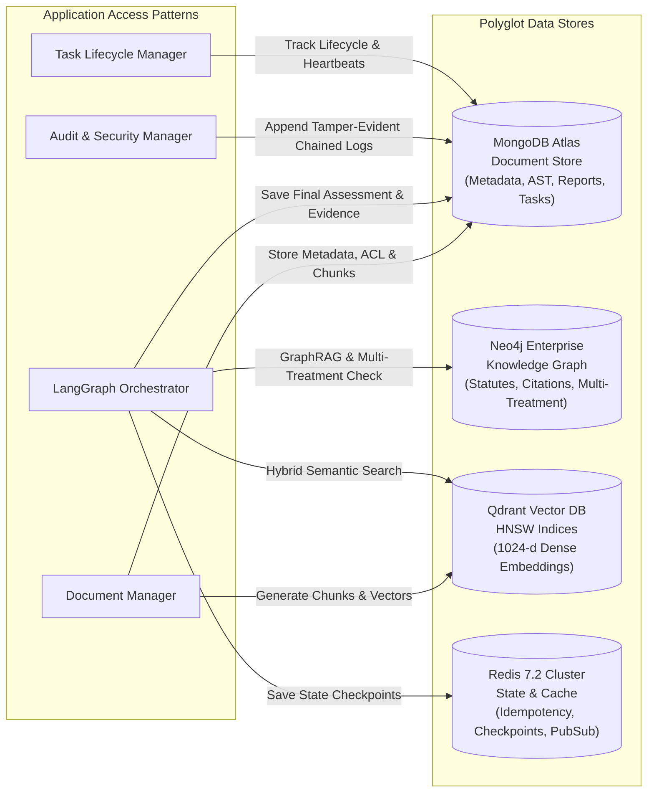
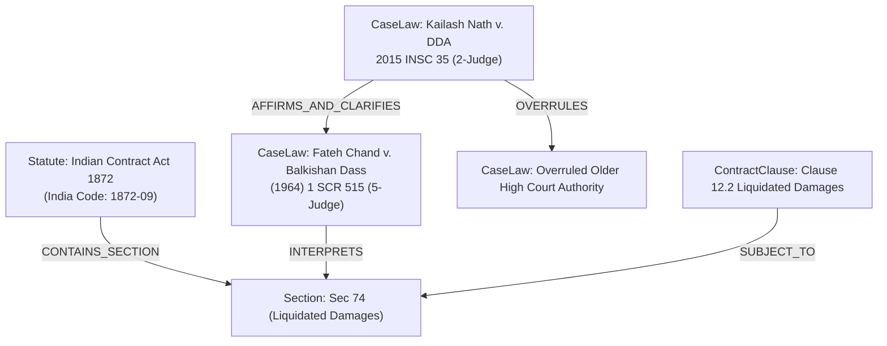

# LegalLens AI – Polyglot Database & Knowledge Graph Design
**Document Version:** 1.1.0  
**Storage Paradigms:** Document (MongoDB Atlas), Graph (Neo4j Enterprise), Vector (Qdrant), In-Memory/Cache (Redis 7.2)  
**Status:** Approved with Technical Refinements  

---

## 1. Storage Strategy & Polyglot Persistence Architecture

Legal documents and reasoning exhibit three fundamentally distinct data structures that cannot be shoehorned into a single database without severe performance or modeling penalties:
1. **Dynamic, Hierarchical Documents (MongoDB Atlas):** Contract clauses, polymorphic agent traces, flexible JSON ASTs, user workspaces, background task statuses, and immutable audit logs.
2. **Relational & Topographical Knowledge (Neo4j Enterprise):** Statutory hierarchies (Act -> Chapter -> Section), judicial precedent treatment topologies (`OVERRULES`, `REVERSES`, `DISTINGUISHES`, `MODIFIES`), case citations, and cross-statute conflicts.
3. **Semantic & Similarity Data (Qdrant Vector DB):** High-dimensional dense vector embeddings of legal paragraphs, case law ratios, and contractual provisions with payload metadata filters.
4. **Transient State & Messaging (Redis 7.2 Cluster):** LangGraph execution state checkpoints, distributed idempotency locks (`Idempotency-Key`), Celery task broker, and real-time SSE pub/sub channels.



---

## 2. MongoDB Atlas Schema Design (Document Data)

All MongoDB collections implement strict Mongoose schemas with type safety, schema validation, and compound indexes to enforce multi-tenant isolation.

### 2.1 Collection: `tenants` (Workspaces)
```typescript
interface ITenant {
  _id: mongoose.Types.ObjectId;
  name: string;
  slug: string; // unique workspace identifier (e.g., 'lex-chambers')
  tier: 'STARTER' | 'PROFESSIONAL' | 'ENTERPRISE';
  jurisdiction_default: 'IN' | 'UK' | 'US' | 'SG';
  compliance_settings: {
    data_retention_days: number;
    ephemeral_processing: boolean; // if true, raw files deleted post-analysis
    dpdp_compliance_mode: boolean; // masks Indian Aadhaar, PAN, phone, email
    allow_external_llm: boolean;
  };
  storage_quota_bytes: number;
  used_storage_bytes: number;
  monthly_token_quota: number;
  used_token_quota: number;
  is_active: boolean;
  created_at: Date;
  updated_at: Date;
}
```
**Indexes:** `{ slug: 1 }` (Unique), `{ is_active: 1, tier: 1 }`

---

### 2.2 Collection: `users`
```typescript
interface IUser {
  _id: mongoose.Types.ObjectId;
  tenant_id: mongoose.Types.ObjectId;
  email: string;
  password_hash: string;
  full_name: string;
  bar_registration_number?: string;
  role: 'PARTNER' | 'SENIOR_ASSOCIATE' | 'ASSOCIATE' | 'PARALEGAL' | 'AUDITOR' | 'ADMIN';
  mfa_enabled: boolean;
  mfa_secret?: string;
  api_keys: Array<{
    key_hash: string;
    label: string;
    created_at: Date;
    last_used_at?: Date;
    expires_at?: Date;
  }>;
  is_verified: boolean;
  status: 'ACTIVE' | 'SUSPENDED' | 'INVITED';
  created_at: Date;
  updated_at: Date;
}
```
**Indexes:** `{ email: 1 }` (Unique), `{ tenant_id: 1, role: 1 }`, `{ tenant_id: 1, status: 1 }`

---

### 2.3 Collection: `documents` (with Ingress Security & ABAC)
```typescript
interface IDocument {
  _id: mongoose.Types.ObjectId;
  tenant_id: mongoose.Types.ObjectId;
  uploader_user_id: mongoose.Types.ObjectId;
  title: string;
  original_filename: string;
  declared_mime_type: string;
  detected_magic_mime: string; // Validated via file-type magic bytes
  file_size_bytes: number;
  sha256_checksum: string; // For cryptographic integrity and deduplication
  storage_uri: string; // S3/MinIO bucket path
  document_type: 
    | 'CONTRACT_MSA'
    | 'CONTRACT_NDA'
    | 'CONTRACT_EMPLOYMENT'
    | 'CONTRACT_LEASE'
    | 'STATUTE_NOTIFICATION'
    | 'COURT_PETITION'
    | 'JUDGMENT'
    | 'OTHER';
  jurisdiction: 'IN' | 'UK' | 'US' | 'SG';
  
  // Ingress Security Scans
  malware_scan: {
    status: 'CLEAN' | 'INFECTED' | 'FAILED' | 'SKIPPED';
    scanned_at?: Date;
    engine: 'ClamAV';
    signature_matches?: string[];
  };

  // Fine-grained Document Authorization (ABAC)
  authorization_acl: {
    owner_user_id: mongoose.Types.ObjectId;
    allowed_user_ids: mongoose.Types.ObjectId[];
    allowed_roles: string[]; // e.g. ['PARTNER', 'SENIOR_ASSOCIATE']
    is_confidential_to_lead_counsel: boolean;
  };

  // Retention and Lifecycle Policies
  retention_policy: {
    retention_expires_at?: Date;
    auto_shred_source_file: boolean; // Hard cryptographic erasure post-analysis
    is_legal_hold: boolean; // Prevents automated purging if true
  };

  ocr_status: 'PENDING' | 'EXTRACTING' | 'COMPLETED' | 'FAILED';
  ocr_metadata?: {
    engine: 'PYMUPDF' | 'TESSERACT_5' | 'HYBRID';
    page_count: number;
    word_count: number;
    average_confidence: number;
    detected_languages: string[];
  };
  processing_progress: number; // 0 to 100 percentage
  tags: string[];
  is_archived: boolean;
  created_at: Date;
  updated_at: Date;
}
```
**Indexes:**
- `{ tenant_id: 1, sha256_checksum: 1 }` (Deduplication within workspace)
- `{ tenant_id: 1, "authorization_acl.owner_user_id": 1 }`
- `{ tenant_id: 1, created_at: -1 }`
- `{ "retention_policy.retention_expires_at": 1 }` (TTL Index for automated purging)

---

### 2.4 Collection: `document_clauses` (AST Structure)
```typescript
interface IDocumentClause {
  _id: mongoose.Types.ObjectId;
  tenant_id: mongoose.Types.ObjectId;
  document_id: mongoose.Types.ObjectId;
  clause_number: string;
  clause_title?: string;
  raw_text: string;
  normalized_text: string;
  clause_type: 
    | 'INDEMNITY'
    | 'LIMITATION_OF_LIABILITY'
    | 'TERMINATION'
    | 'GOVERNING_LAW_AND_JURISDICTION'
    | 'DISPUTE_RESOLUTION_ARBITRATION'
    | 'CONFIDENTIALITY'
    | 'NON_COMPETE'
    | 'INTELLECTUAL_PROPERTY'
    | 'FORCE_MAJEURE'
    | 'PAYMENT_TERMS'
    | 'REPRESENTATIONS_AND_WARRANTIES'
    | 'MISCELLANEOUS';
  page_span: {
    start_page: number;
    end_page: number;
    bounding_boxes?: Array<{
      page: number;
      x0: number;
      y0: number;
      x1: number;
      y1: number;
    }>;
  };
  cross_references: string[];
  vector_point_id: string; // Pointer to Qdrant vector point
  token_length: number;
  created_at: Date;
}
```
**Indexes:**
- `{ tenant_id: 1, document_id: 1, clause_number: 1 }` (Unique)
- `{ document_id: 1, clause_type: 1 }`

---

### 2.5 Collection: `legal_risks` (Decoupled XAI & Exact Evidence Storage)
```typescript
interface ILegalRisk {
  _id: mongoose.Types.ObjectId;
  tenant_id: mongoose.Types.ObjectId;
  document_id: mongoose.Types.ObjectId;
  session_id: mongoose.Types.ObjectId;
  clause_id: mongoose.Types.ObjectId;
  clause_number: string;
  
  risk_category: 
    | 'STATUTORY_UNENFORCEABILITY'
    | 'UNBOUNDED_FINANCIAL_LIABILITY'
    | 'ONE_SIDED_TERMINATION'
    | 'REGULATORY_NON_COMPLIANCE'
    | 'JURISDICTIONAL_DEFECT'
    | 'AMBIGUOUS_OBLIGATION'
    | 'IP_EXPOSURE';
  
  severity: 'CRITICAL' | 'HIGH' | 'MEDIUM' | 'LOW' | 'INFORMATIONAL';
  calibrated_risk_score: number; // 0.0 to 1.0 from Structured ML Model

  // Structured Tabular Features fed to the Predictive ML Model
  structured_features: {
    clause_length_tokens: number;
    liability_cap_ratio: number; // e.g. 1.0x, 2.0x, -1 if uncapped
    has_unilateral_termination: boolean;
    indemnity_carveouts_count: number;
    non_compete_duration_months: number;
    jurisdiction_divergence_flag: boolean;
    ambiguity_entropy_score: number;
    penalty_doctrine_indicator: boolean;
  };

  // Model-Based Quantitative Explainability (TreeSHAP)
  model_based_explanation: {
    base_value: number; // Model expected output
    shap_feature_attributions: Array<{
      feature_name: string;
      feature_value: any;
      attribution_weight: number; // Marginal contribution to risk score
    }>;
  };

  // LLM Qualitative Legal Narrative (IRAC Format)
  llm_reasoning_narrative: {
    issue: string;
    rule: string;
    application: string;
    conclusion: string;
  };

  // Exact Stored Supporting Evidence
  supporting_evidence: {
    exact_clause_text: string;
    bounding_box_coordinates?: Array<{ page: number; x0: number; y0: number; x1: number; y1: number }>;
    statutory_provisions: Array<{
      india_code_act_title: string;
      section_number: string;
      exact_section_excerpt: string;
      official_source_url: string; // e.g. indiacode.nic.in link
    }>;
    judicial_authorities: Array<{
      digiscr_neutral_citation: string;
      case_title: string;
      official_scr_citation?: string;
      exact_ratio_decidendi_excerpt: string;
      treatment_status: 'ACTIVE' | 'OVERRULED' | 'REVERSED' | 'DISTINGUISHED' | 'MODIFIED';
    }>;
  };

  // Evidence Verification & Abstention Flags
  verification_signal: {
    calibrated_nli_score: number;
    is_abstention: boolean;
    abstention_reason?: 'INSUFFICIENT_EVIDENCE' | 'CONFLICTING_AUTHORITIES' | 'AMBIGUOUS_STATUTORY_INTERPRETATION';
  };

  mitigation_recommendation: {
    recommended_amendment: string;
    clean_replacement_text: string;
    fallback_negotiation_position: string;
  };

  hitl_reviewed: boolean;
  hitl_override?: {
    original_severity: string;
    modified_severity: string;
    reviewer_notes: string;
    reviewed_by: mongoose.Types.ObjectId;
    reviewed_at: Date;
  };
  created_at: Date;
}
```
**Indexes:**
- `{ session_id: 1, severity: 1 }`
- `{ document_id: 1, clause_id: 1 }`
- `{ tenant_id: 1, risk_category: 1 }`

---

### 2.6 Collection: `background_tasks` (Async Task Lifecycle)
```typescript
interface IBackgroundTask {
  _id: mongoose.Types.ObjectId;
  task_id: string; // Celery task UUID or internal ID
  tenant_id: mongoose.Types.ObjectId;
  user_id: mongoose.Types.ObjectId;
  task_type: 'OCR_EXTRACTION' | 'MULTI_AGENT_ANALYSIS' | 'SCENARIO_SIMULATION' | 'REPORT_EXPORT';
  status: 'PENDING' | 'STARTED' | 'PROCESSING' | 'RETRY' | 'SUCCESS' | 'FAILED' | 'REVOKED';
  progress_percentage: number; // 0 to 100
  current_step_description: string;
  retries_attempted: number;
  max_retries: number;
  result_payload?: any;
  error_details?: {
    code: string;
    message: string;
    stack_trace?: string;
  };
  heartbeat_at: Date;
  created_at: Date;
  updated_at: Date;
}
```
**Indexes:**
- `{ task_id: 1 }` (Unique)
- `{ tenant_id: 1, status: 1 }`
- `{ heartbeat_at: 1 }`

---

### 2.7 Collection: `audit_trails` (Tamper-Evident Chained Log)
```typescript
interface IAuditTrail {
  _id: mongoose.Types.ObjectId;
  tenant_id: mongoose.Types.ObjectId;
  user_id?: mongoose.Types.ObjectId;
  actor_type: 'USER' | 'SYSTEM_AGENT' | 'API_KEY';
  action: 
    | 'DOCUMENT_UPLOAD'
    | 'DOCUMENT_MALWARE_SCAN'
    | 'DOCUMENT_DELETE'
    | 'ANALYSIS_STARTED'
    | 'HITL_OVERRIDE'
    | 'REPORT_EXPORTED'
    | 'SIMULATION_EXECUTED'
    | 'KEY_ROTATED';
  resource_type: 'DOCUMENT' | 'ANALYSIS' | 'RISK' | 'REPORT' | 'USER';
  resource_id: mongoose.Types.ObjectId;
  ip_address: string;
  user_agent: string;
  details: Record<string, any>;
  previous_entry_hash: string;
  current_entry_hash: string; // HMAC-SHA256(previous_hash + action + timestamp + payload)
  timestamp: Date;
}
```
**Indexes:** `{ tenant_id: 1, timestamp: -1 }`, `{ current_entry_hash: 1 }` (Unique)

---

## 3. Neo4j Knowledge Graph: Multi-Treatment Judicial Topology

The Neo4j Knowledge Graph represents statutory hierarchies from **India Code** and judicial treatments from the **Supreme Court of India (DigiSCR)** and High Courts.



### 3.1 Judicial Treatment Status & Relationships

| Relationship Type | Source Node -> Target Node | Legal Significance |
| :--- | :--- | :--- |
| `OVERRULES` | `(:CaseLaw) -> (:CaseLaw)` | Later / Larger bench declares prior decision invalid. |
| `REVERSES` | `(:CaseLaw) -> (:CaseLaw)` | Appellate bench overturns lower court decision in the same litigation. |
| `DISTINGUISHES` | `(:CaseLaw) -> (:CaseLaw)` | Court declines to apply precedent due to factual divergence. |
| `MODIFIES` | `(:CaseLaw) -> (:CaseLaw)` | Subsequent judgment alters or restricts the legal scope of the doctrine. |
| `AFFIRMS` | `(:CaseLaw) -> (:CaseLaw)` | Later bench expressly upholds prior judicial ratio. |
| `INTERPRETS` | `(:CaseLaw) -> (:Section)` | Judicial ratio defines or clarifies the statutory section. |
| `CONTAINS_SECTION` | `(:Statute) -> (:Section)` | Structural legislative containment from official India Code. |

### 3.2 Cypher Multi-Treatment Verification Query
```cypher
// Query to verify whether a candidate precedent is legally active or compromised
MATCH (c:CaseLaw {neutral_citation: $target_neutral_citation})
OPTIONAL MATCH (overruler:CaseLaw)-[:OVERRULES]->(c)
OPTIONAL MATCH (reverser:CaseLaw)-[:REVERSES]->(c)
OPTIONAL MATCH (modifier:CaseLaw)-[:MODIFIES]->(c)
OPTIONAL MATCH (distinguisher:CaseLaw)-[:DISTINGUISHES]->(c)
RETURN 
  c.title AS CaseTitle,
  c.neutral_citation AS Citation,
  c.bench_strength AS BenchStrength,
  c.decision_date AS DecisionDate,
  CASE 
    WHEN overruler IS NOT NULL THEN 'OVERRULED'
    WHEN reverser IS NOT NULL THEN 'REVERSED'
    WHEN modifier IS NOT NULL THEN 'MODIFIED'
    WHEN distinguisher IS NOT NULL THEN 'DISTINGUISHED'
    ELSE 'ACTIVE'
  END AS JudicialTreatmentStatus,
  collect(DISTINCT overruler.neutral_citation) AS OverruledByCitations,
  collect(DISTINCT modifier.neutral_citation) AS ModifiedByCitations;
```

---

## 4. Vector Database Schema (Qdrant)

Dense vector collections strictly apply tenant payload filtering.

### 4.1 Collection: `sovereign_statutes_india`
- **Embedding Model:** `BAAI/bge-large-en-v1.5` (Dense 1024-d, Cosine similarity)
- **HNSW Parameters:** `m = 16`, `ef_construct = 128`
- **Payload Schema:**
```json
{
  "india_code_act_id": "1872-09",
  "act_title": "The Indian Contract Act, 1872",
  "chapter": "II",
  "section_number": "27",
  "section_title": "Agreement in restraint of trade, void",
  "section_text": "Every agreement by which any one is restrained from exercising a lawful profession, trade or business...",
  "official_source_url": "https://www.indiacode.nic.in/handle/123456789/2187",
  "is_repealed": false,
  "enactment_year": 1872
}
```

---

## 5. Database Migration & Index Management

1. **MongoDB Migrations:** Implemented via programmatic Node.js migration scripts (`migrate-mongo`) executed in CI/CD before service deployment. Migrations maintain a `migrations` metadata collection ensuring idempotent schema evolution.
2. **Neo4j Constraints & Indexes:** Managed via versioned Cypher DDL migration scripts applying unique constraints on startup:
   ```cypher
   CREATE CONSTRAINT unique_statute_code IF NOT EXISTS FOR (s:Statute) REQUIRE s.code IS UNIQUE;
   CREATE CONSTRAINT unique_case_citation IF NOT EXISTS FOR (c:CaseLaw) REQUIRE c.neutral_citation IS UNIQUE;
   CREATE INDEX precedent_treatment_status IF NOT EXISTS FOR (c:CaseLaw) ON (c.treatment_status);
   ```
3. **Qdrant Index Provisioning:** Automated Python bootstrap scripts verify collection schemas, configure HNSW parameters, and create keyword payload index filters before ingesting legal embeddings.
