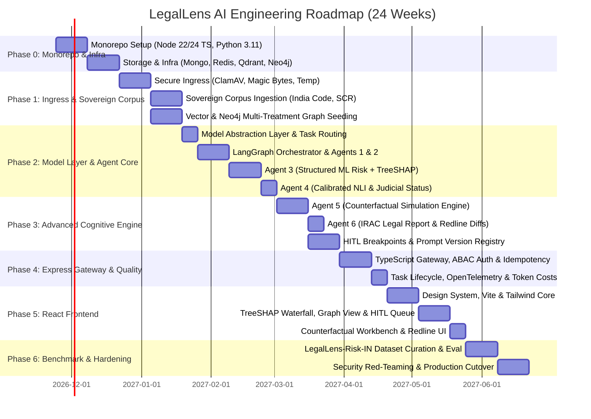

# LegalLens AI – Master Development Roadmap
**Document Version:** 1.1.0  
**Target Architecture:** Modular Monorepo with Incremental Implementation  
**Target Timeline:** 24 Weeks (6 Distinct Engineering Phases)  
**Status:** Approved with Technical Refinements  

---

## 1. Roadmap Overview & Strategic Implementation Philosophy

The development roadmap for **LegalLens AI** follows an **Incremental Modular Monorepo** strategy. Rather than deploying a complex web of distributed microservices on Day 1, the platform begins in a unified workspace (`apps/web`, `apps/api-gateway`, `apps/ai-engine`, `packages/shared-types`). Each module maintains strictly isolated domain boundaries, typed API contracts, and dedicated test suites. This allows seamless local development and integration testing while ensuring the system can be split into distributed, containerized microservices without architectural rework when scaling demands dictate.

---

## 2. Phase-by-Phase Work Breakdown Structure (WBS)

### Phase 0: Monorepo Scaffolding & Polyglot Database Setup (Weeks 1–4)
- **Week 1–2: Monorepo & Environment Initialization**
  - Initialize clean monorepo (`apps/web`, `apps/api-gateway`, `apps/ai-engine`, `packages/shared-types`).
  - Standardize API Gateway on **Node.js 22 LTS / Node.js 24 LTS** with strict **TypeScript 5.x**.
  - Setup Python 3.11 virtual environment with `uv` package manager and Pydantic v2.
  - Configure Docker Compose orchestrating MongoDB Atlas Local/Community, Redis 7.2, Qdrant, Neo4j 5 Enterprise, MinIO, and ClamAV daemon.
- **Week 3–4: Storage Engine Provisioning & Migration Scaffolding**
  - Establish Mongoose migration scripts and compound indexes (`tenant_id`, `created_at`, `sha256_checksum`).
  - Provision Qdrant collections with HNSW cosine distance indexing and payload schema filters.
  - Setup Neo4j schema: Unique constraints and indexes for `Statute.code`, `Section.uri`, and `CaseLaw.neutral_citation`.
  - Implement Redis atomic locking for API idempotency.

### Phase 1: Ingress Security, Parsing & Sovereign Corpus Ingestion (Weeks 5–8)
- **Week 5–6: Secure Document Ingress & Dual Parsing Pipeline**
  - Implement ingress sanitization: ClamAV streaming anti-virus scan, MIME magic byte validation via `file-type`, and secure temporary storage with auto-shredding.
  - Implement dual parsing strategy: PyMuPDF (`fitz`) for digital PDFs + OpenCV preprocessing (binarization, deskewing) and Tesseract 5 OCR for scanned deeds.
  - Develop hierarchical AST clause segmenter recognizing legal numbering (`1.`, `1.1`, `(a)`, `(i)`) with bounding box preservation.
- **Week 7–8: Sovereign Indian Legal Corpus Ingestion & Graph Seeding**
  - Ingest Central Acts from the **official India Code portal (`indiacode.nic.in`)** and **The Gazette of India (`egazette.gov.in`)**:
    - *Indian Contract Act, 1872*
    - *Arbitration and Conciliation Act, 1996*
    - *Specific Relief Act, 1963*
    - *Companies Act, 2013*
    - *Bharatiya Nyaya Sanhita, 2023 (cross-mapped to IPC 1860)*
    - *Digital Personal Data Protection Act, 2023 (DPDP Act)*
    - *Information Technology Act, 2000*
  - Ingest official Supreme Court judgment records from **Supreme Court Digital Reports (`digiscr.sci.gov.in`)** and High Court rulings from **`judgments.ecourts.gov.in`**.
  - Seed Neo4j with multi-treatment judicial relationships: `OVERRULES`, `REVERSES`, `DISTINGUISHES`, `MODIFIES`, and `CITES`.
  - Populate dense vector embeddings using `BAAI/bge-large-en-v1.5` and build BM25 sparse indices.

### Phase 2: Model Abstraction Layer & Core Agents (Weeks 9–12)
- **Week 9: Model Abstraction Layer & LangGraph State Core**
  - Implement `ModelProvider` abstraction layer supporting Google Gemini (`gemini-2.5-flash`, `gemini-2.5-pro`, `gemini-2.0-flash`), OpenAI, Anthropic, and local HuggingFace/vLLM endpoints.
  - Configure environment-driven model routing (`LLM_MODEL_EXTRACTION`, `LLM_MODEL_RESEARCH`, `LLM_MODEL_VERIFICATION`, `LLM_MODEL_REASONING`).
  - Initialize LangGraph `LegalLensGraphState` with Redis-backed state persistence.
- **Week 10: Document Understanding & Legal Research Agents**
  - Implement **Agent 1 (Document Understanding)** using `LLM_MODEL_EXTRACTION` for fast clause AST extraction.
  - Implement **Agent 2 (Legal Research)**: Hybrid RAG router (Qdrant Dense + BM25 Sparse + RRF + `BAAI/bge-reranker-large`) + Neo4j Graph traversal filtering out overruled or reversed precedents.
- **Week 11: Structured ML Risk Predictor & TreeSHAP (Agent 3)**
  - Train dedicated tabular risk classifier (LightGBM / XGBoost) on structured contract features.
  - Integrate TreeSHAP explainer microservice for sub-second mathematical feature attributions.
  - Generate qualitative IRAC legal narratives using the LLM, referencing exact evidence.
- **Week 12: Evidence Verification Agent (Agent 4)**
  - Implement calibrated Natural Language Inference (NLI) as a supporting verification signal.
  - Establish explicit **Abstention mechanism (`ABSTAIN / INSUFFICIENT_EVIDENCE`)** for low-confidence or contradictory authorities.
  - Implement 4-way judicial treatment verification (`OVERRULED`, `REVERSED`, `DISTINGUISHED`, `MODIFIED`).

### Phase 3: Advanced Cognitive Capabilities & Explainability (Weeks 13–16)
- **Week 13–14: Scenario Simulation & Legal Report Generation (Agents 5 & 6)**
  - Implement **Agent 5 (Scenario Simulation)** using `LLM_MODEL_REASONING`: Counterfactual "What-If" stress testing (breach, IBC insolvency, penalty challenge).
  - Implement **Agent 6 (Report Generation)**: IRAC-structured formal legal memorandum synthesis, automated clause redlining engine (diff-match-patch), and executive summary synthesis.
- **Week 15–16: HITL Interactivity, Prompt Versioning & Observability**
  - Deploy LangGraph `interrupt_before` breakpoints for high-risk clauses (risk score > 0.75), yielding execution control for lawyer review.
  - Create versioned prompt registry (`/prompts/*.yaml`) with semver tracking.
  - Implement OpenTelemetry / Langfuse tracing and real-time token/cost accounting.

### Phase 4: Express.js TypeScript Gateway & Platform Hardening (Weeks 17–18)
- **Week 17: TypeScript Gateway, ABAC & Idempotency**
  - Build Express.js TypeScript Gateway with Zod validation.
  - Implement JWT authentication with refresh token rotation and MFA support.
  - Enforce Attribute-Based Access Control (ABAC: Partner, Senior Associate, Associate, Paralegal, Auditor).
  - Implement Redis-backed `Idempotency-Key` validation and rate limiting.
- **Week 18: Task Status Engine & Tamper-Evident Audit Trails**
  - Implement background task lifecycle manager (`/api/v1/tasks/:id`) with real-time SSE streaming.
  - Implement HMAC-SHA256 cryptographically chained audit logging.

### Phase 5: React Frontend & Interactive Legal Workbench (Weeks 19–21)
- **Week 19: Design System & Document Viewer**
  - Build responsive legal workspace with Tailwind CSS, Lucide React, and Framer Motion.
  - Implement PDF viewer with synchronized clause highlighting and bounding-box overlays.
- **Week 20: TreeSHAP Waterfall & Knowledge Graph Visualizer**
  - Develop Recharts visualizers rendering TreeSHAP feature attributions alongside qualitative IRAC narratives.
  - Build interactive Cytoscape.js canvas visualizing Neo4j statutory paths, overruling trees, and precedent citations.
- **Week 21: Counterfactual Workbench & Interactive Redlining UI**
  - Implement split-pane redline editor with real-time clause diffing and instant re-simulation triggers.
  - Build human-in-the-loop review queue for one-click approval or risk adjustment.

### Phase 6: Benchmark Evaluation, Security Red-Teaming & Production Launch (Weeks 22–24)
- **Week 22: Research Benchmarking & Proposed `LegalLens-Risk-IN` Evaluation**
  - Finalize protocol and dataset release for the proposed `LegalLens-Risk-IN` benchmark dataset (1,500 target clauses).
  - Benchmark against **ILDC**, **InLegalNER**, and **ContractNLI**.
  - Measure NLI calibration error (ECE), Ragas Faithfulness, and Citation Precision/Recall.
- **Week 23: Security Red-Teaming & Compliance Auditing**
  - Execute penetration testing on file ingress (ClamAV, magic bytes, zip bomb resistance).
  - Test prompt injection defenses (Dual-LLM guardrail, XML tag boundaries).
  - Validate DPDP Act 2023 compliance, PII redaction, and cryptographic data deletion policies.
- **Week 24: Pilot Deployment & Handover**
  - Deploy Kubernetes manifests with Helm charts, Prometheus/Grafana monitoring, and automated failover.

---

## 3. Key Milestones and Acceptance Gates

| Milestone | Target Week | Acceptance Criteria |
| :--- | :--- | :--- |
| **M1: Sovereign Knowledge Base Ready** | Week 8 | India Code Central Acts & DigiSCR precedents seeded in Qdrant & Neo4j with multi-treatment edges; ClamAV ingress scanner functional. |
| **M2: Model Abstraction & Agents 1-4**| Week 12 | Model Abstraction Layer routes tasks across configured models; Agent 3 computes TreeSHAP feature attributions; Agent 4 verifies citations with explicit abstention. |
| **M3: Advanced Reasoning & HITL Live** | Week 16 | Agent 5 executes counterfactual breach simulations; Agent 6 outputs IRAC memorandum with redline diffs; HITL pause/resume operates seamlessly via Redis. |
| **M4: TypeScript Gateway & Security** | Week 18 | Express TypeScript Gateway enforces ABAC, Idempotency keys, and chained HMAC audit logging; background tasks report live progress. |
| **M5: Interactive Frontend Complete** | Week 21 | Full UI flow operational: Ingress -> Live Telemetry -> TreeSHAP Waterfall -> Redline Editor -> Graph Explorer -> Report Export. |
| **M6: Research Caliber & Production Launch**| Week 24 | Ragas Faithfulness $\ge 0.92$; Citation Hallucination Rate $\le 0.5\%$; `LegalLens-Risk-IN` Macro F1 $\ge 0.88$; Zero prompt injection vulnerabilities. |
