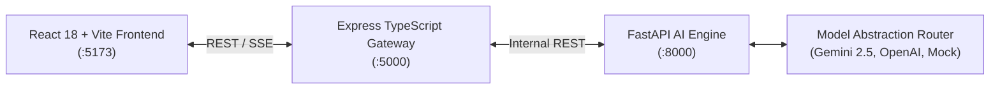

# LegalLens AI – Advanced Agentic Legal Intelligence System
**Target Jurisdiction (Initial):** Republic of India (Common Law / Civil Law Extensible)  
**Architecture:** Modular Monorepo (React 18 + Vite, Node.js 24 LTS TypeScript Express, Python 3.12 FastAPI, LangGraph)  
**Status:** Phase 1: Engineering Foundation  

---

## 1. Project Overview & Architecture

LegalLens AI is an enterprise-grade multi-agent legal intelligence platform designed for:
- Evidence-grounded contract understanding,
- Sovereign statutory retrieval (**India Code**) and active case law tracking (**Supreme Court Digital Reports - DigiSCR**),
- Decoupled, explainable risk assessment utilizing a dedicated structured machine learning model with **TreeSHAP** feature attribution,
- Calibrated Natural Language Inference (NLI) evidence verification with explicit abstention, and
- Counterfactual scenario simulation for contractual liabilities.



---

## 2. Monorepo Directory Structure

```
legallens/
├── apps/
│   ├── web/                    # React 18 + Vite + Tailwind CSS Frontend (:5173)
│   ├── api-gateway/            # Express.js TypeScript API Gateway (:5000)
│   └── ai-engine/              # FastAPI Python 3.12 AI Intelligence Engine (:8000)
├── packages/
│   └── shared-types/           # Shared Zod validation schemas & TypeScript types
├── benchmarks/                 # Research evaluation scripts (ILDC, InLegalNER, LegalLens-Risk-IN)
├── prompts/                    # Semantic-versioned prompt YAML templates
├── docs/                       # Architecture documentation index
├── ARCHITECTURE.md             # System architecture & component specification
├── ARCHITECTURE_DECISIONS.md   # Architectural Decision Records (ADRs)
├── DEVELOPMENT_ROADMAP.md       # 24-week engineering phases
├── DATABASE_DESIGN.md          # Polyglot storage & Neo4j graph schema
├── AI_AGENT_DESIGN.md          # Multi-agent LangGraph specification
├── API_DESIGN.md               # RESTful OpenAPI & SSE specifications
├── SECURITY_DESIGN.md          # Ingress security & DPDP 2023 compliance
└── RESEARCH_EVALUATION.md      # Evaluation metrics & benchmark corpora
```

---

## 3. Quick Start & Setup Instructions (Windows PowerShell)

### Step 1: Environment Variables Setup
Copy the environment templates in the root, API gateway, and AI engine:

```powershell
# In project root (c:\Users\Sangavii\legallens)
Copy-Item .env.example .env
Copy-Item apps/api-gateway/.env.example apps/api-gateway/.env
Copy-Item apps/ai-engine/.env.example apps/ai-engine/.env
Copy-Item apps/web/.env.example apps/web/.env
```

If you possess a Google Gemini API Key, set it in `apps/ai-engine/.env`:
```ini
DEFAULT_LLM_PROVIDER=google
GEMINI_API_KEY=your_gemini_api_key_here
```
*(Note: If no API key is provided, the AI Engine defaults to `DEFAULT_LLM_PROVIDER=mock`, allowing complete local testing without external API calls).*

---

### Step 2: Install Node.js Dependencies

```powershell
# 1. Install and compile Shared Types
cd packages/shared-types
npm.cmd install
npm.cmd run build
cd ../..

# 2. Install API Gateway dependencies
cd apps/api-gateway
npm.cmd install
cd ../..

# 3. Install Web Frontend dependencies
cd apps/web
npm.cmd install
cd ../..
```

---

### Step 3: Install Python AI Engine Dependencies

```powershell
cd apps/ai-engine
python -m pip install -r requirements.txt
cd ../..
```

---

## 4. Running the Platform Services

To run all three services concurrently in development mode, open three separate Windows PowerShell terminals:

### Terminal 1: Run Express.js API Gateway (Port 5000)
```powershell
cd apps/api-gateway
npm.cmd run dev
```
*Health Check Endpoint:* `http://localhost:5000/api/v1/health`

### Terminal 2: Run FastAPI AI Engine (Port 8000)
```powershell
cd apps/ai-engine
python main.py
```
*Health Check Endpoint:* `http://localhost:8000/health` or `http://localhost:8000/api/v1/health`  
*Interactive Swagger UI:* `http://localhost:8000/docs`

### Terminal 3: Run React Web Frontend (Port 5173)
```powershell
cd apps/web
npm.cmd run dev
```
*Web Application:* `http://localhost:5173`

---

## 5. Running the Test Suites

Execute the automated test suites across all packages:

```powershell
# 1. Run Shared Types Zod Schema Tests
cd packages/shared-types
node --test dist/index.test.js
cd ../..

# 2. Run API Gateway Integration & Health Tests
cd apps/api-gateway
npm.cmd test
cd ../..

# 3. Run FastAPI AI Engine Unit & Health Tests
cd apps/ai-engine
python -m pytest tests/
cd ../..

# 4. Verify Frontend Production Build
cd apps/web
npm.cmd run build
cd ../..
```
